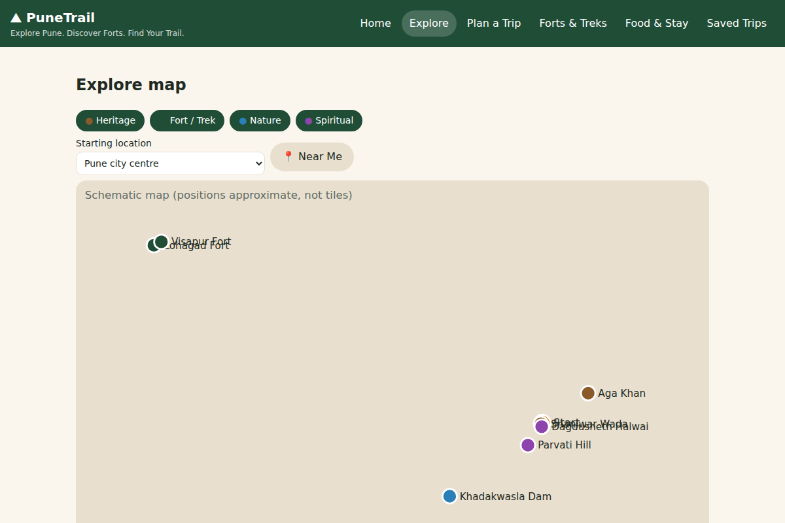
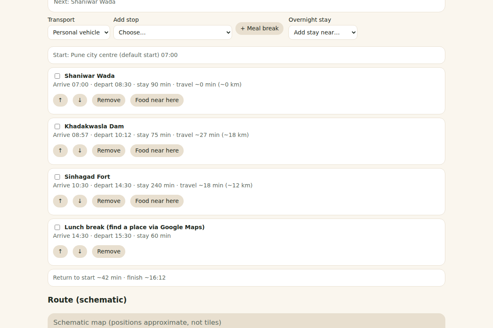

# ⛰ PuneTrail

**Explore Pune. Discover Forts. Find Your Trail.**

A lightweight, single-page trip planner for Pune, Maharashtra: browse forts and heritage sites, build a one-day itinerary, tick off checkpoints, and open the route in Google Maps. Everything runs in the browser from one file, with no build step and no API keys.

**Live demo:** https://YOUR-USERNAME.github.io/YOUR-REPO/ *(replace after enabling GitHub Pages)*

## Features
- Schematic map of 11 Pune-area destinations with category filters and info cards
- Trip planner: start time, transport, destination picker, auto-ordered itinerary with arrival/departure times
- Warnings for trekking after dark, over-long days and multiple treks in one day
- Edit trips: reorder, remove, add stops, meal breaks, overnight-stay placeholder
- Checkpoint tracker with progress bar; trips and progress saved in your browser (`localStorage`)
- Forts & Treks page with safety guidance; Google Maps links for navigation, food and stays
- Responsive layout with light and dark mode

## Run locally
Open `index.html` in a browser. No install needed.

## Deploy with GitHub Pages
Repo **Settings → Pages → Deploy from a branch → `main` / `(root)` → Save**.

## Limitations (please read)
- The map is a **schematic** drawing, not real map tiles. Positions are approximate.
- Travel times are estimates (straight-line distance × 1.4 at assumed speeds), **not live road routing**.
- Coordinates, trek durations and difficulty are rough guidance. Opening hours, fees and access rules are **not verified**; check locally before travelling.
- Food and stay buttons open live Google Maps searches; no listings, ratings or prices are stored.
- Trips are stored only in the browser; nothing syncs between devices.
- Google Maps opens in a new tab; it is not embedded.

## Roadmap
- [ ] Real interactive map (Leaflet + OpenStreetMap)
- [ ] Optional accounts and cloud-saved trips (Firebase)
- [ ] Verified destination data with sources and last-checked dates

## Contributing
Issues and pull requests are welcome. Please keep changes small and explain what you tested.

## License
MIT. See [LICENSE](LICENSE).
